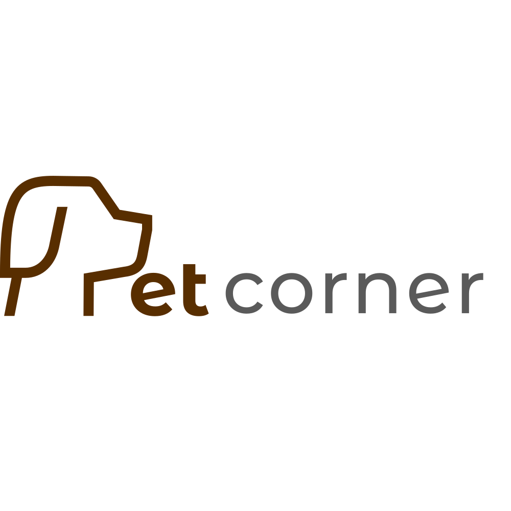
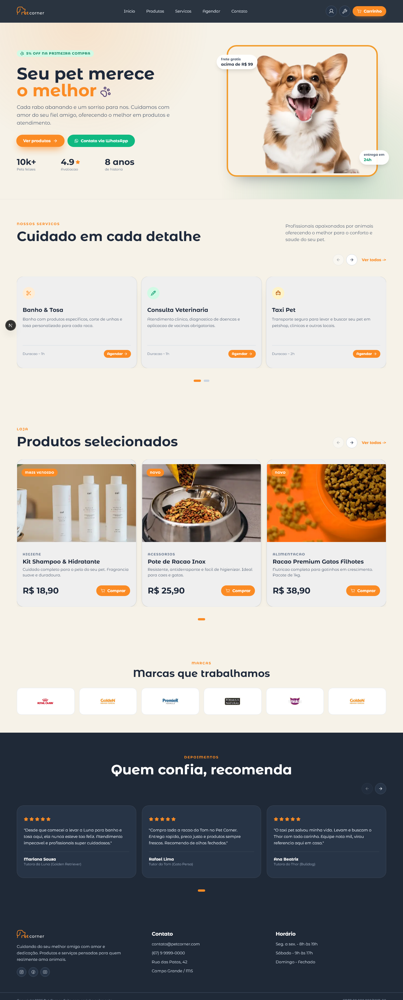
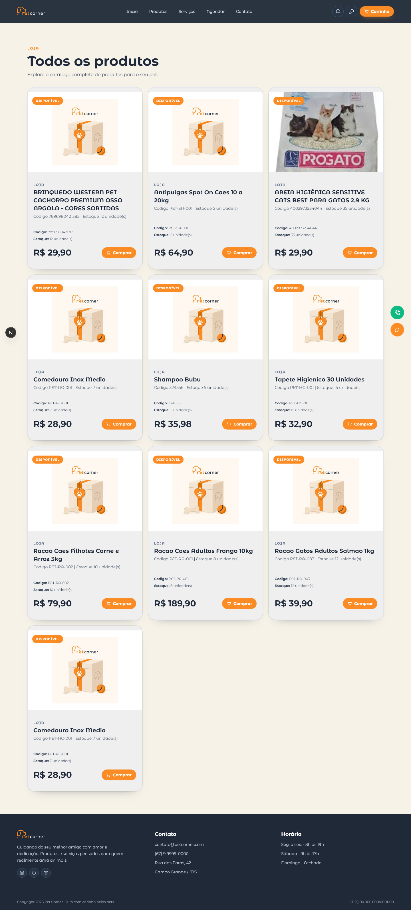
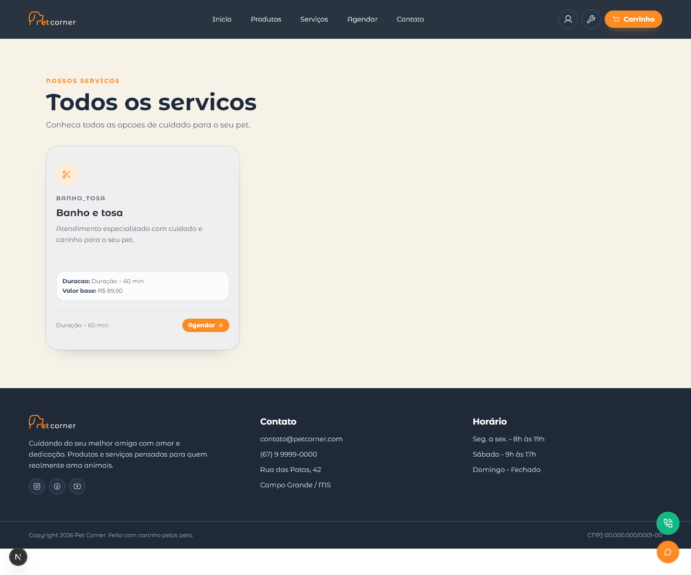
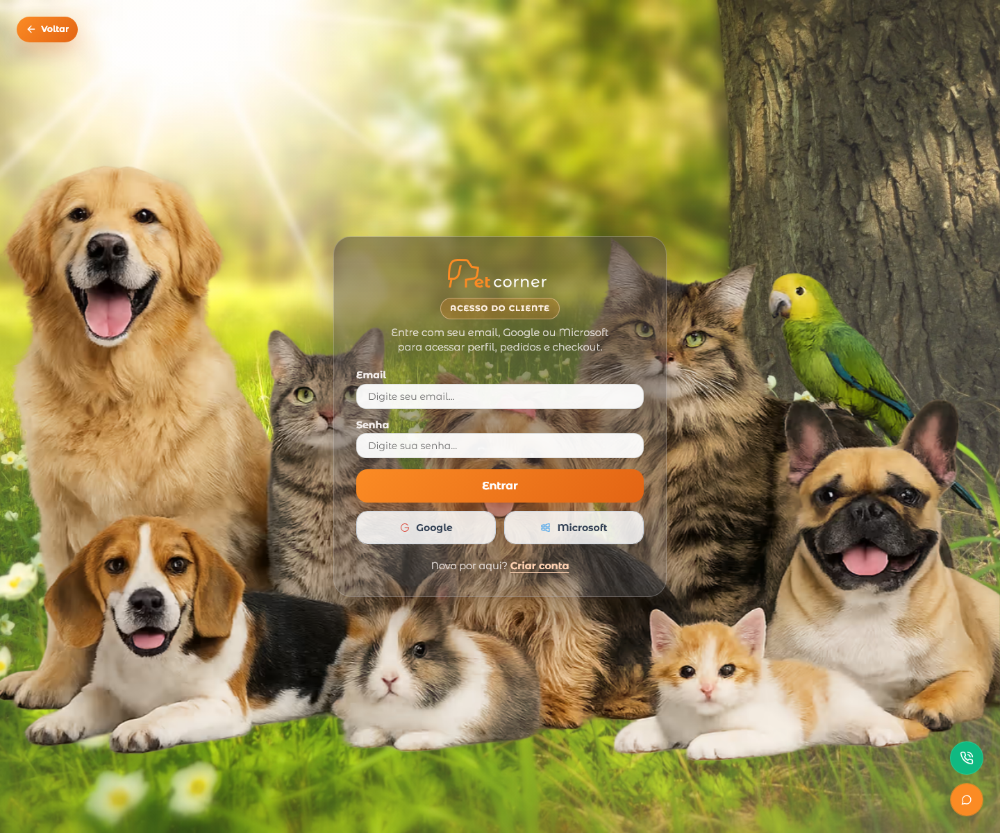
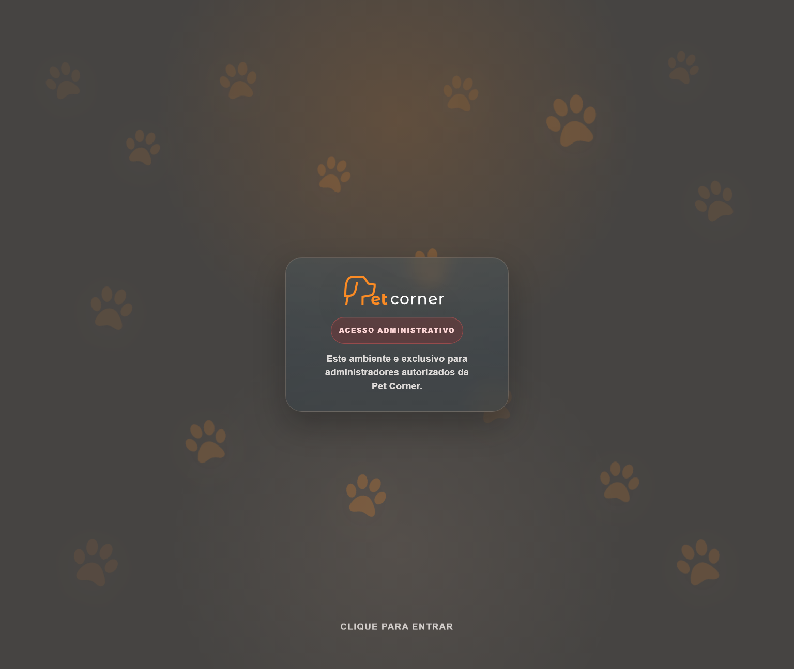
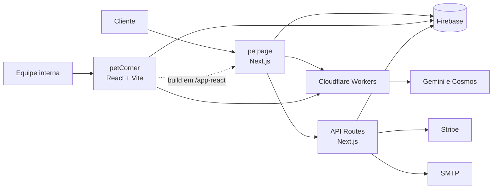

<div align="center">



# PetCornerNext

**Plataforma full-stack para a jornada de compra e a operação de um pet shop.**

[](https://github.com/Gust4v0Di4sC/Pet-Corner-Next/actions/workflows/ci-vercel.yml)
[](https://nextjs.org/)
[](https://react.dev/)
[](#licenca)

[Ver demonstração](https://pet-corner.vercel.app/) · [Documentação](./docs/index.mdx) · [Reportar problema](https://github.com/Gust4v0Di4sC/Pet-Corner-Next/issues)

</div>

<p align="center">
  
</p>

## Sobre

**PetCornerNext** reúne a experiência pública, a área do cliente e a administração de um pet shop em um único monorepo. A plataforma cobre da descoberta de produtos e serviços ao pós-venda, com autenticação, carrinho, checkout, agendamentos, pedidos e rastreamento.

O projeto combina uma aplicação **Next.js** voltada ao cliente com uma SPA administrativa em **React e Vite**. O painel é gerado como parte do build e incorporado à entrega principal pela rota `/app-react`.

## Funcionalidades

- **Vitrine e catálogo** — landing page, produtos, serviços, detalhes, favoritos e busca.
- **Conta do cliente** — cadastro, login, sessão segura, perfil, endereços e pets.
- **Compra e pagamento** — carrinho persistente, checkout Stripe e confirmação de pedidos por webhook.
- **Agendamentos** — consulta de disponibilidade, reserva de horários, notificações e links de calendário.
- **Operação administrativa** — dashboard e gestão de clientes, pets, catálogo, serviços, pedidos e depoimentos.
- **Integrações auxiliares** — sincronização de catálogo, upload de imagens e chat por Cloudflare Workers.

## Interface

| Catálogo de produtos | Catálogo de serviços |
| --- | --- |
|  |  |

| Área do cliente | Acesso administrativo |
| --- | --- |
|  |  |

## Tecnologias

| Área | Stack |
| --- | --- |
| Front-end público | Next.js 16, React 19, TypeScript, Tailwind CSS, Radix UI |
| Painel administrativo | React 19, Vite 7, Material UI, React Router |
| Dados e autenticação | Firebase Auth, Firestore, Firebase Admin SDK |
| Estado e formulários | TanStack Query, Zustand, React Hook Form, Zod |
| Integrações | Stripe, Nodemailer/SMTP, Cloudflare Workers, Gemini, Cosmos Bluesoft |
| Infraestrutura | npm workspaces, Vercel, Docker, GitHub Actions |

## Arquitetura



O monorepo separa as responsabilidades em dois workspaces:

```text
apps/
├── petpage/      # App público, área do cliente e APIs server-side
└── petCorner/    # SPA de administração e operação do pet shop
```

O `petpage` organiza a aplicação pública por domínios em `src/features`. O `petCorner` separa telas, componentes, hooks, serviços e validações. Durante o build completo, o bundle Vite é escrito em `apps/petpage/public/app-react` antes da compilação do Next.js.

> Consulte a [documentação de arquitetura](./docs/arquitetura/petpage.mdx) e o [fluxo de integração do painel](./docs/arquitetura/app-react.mdx) para os detalhes técnicos.

## Executando localmente

### Pré-requisitos

- Node.js 22 ou superior
- npm
- Um projeto Firebase configurado

### Instalação

```bash
git clone https://github.com/Gust4v0Di4sC/Pet-Corner-Next.git
cd Pet-Corner-Next
npm install
```

Configure `apps/petpage/.env.local` e `apps/petCorner/.env` conforme o [guia de variáveis de ambiente](./docs/setup/ambiente.mdx). Valores reais de chaves, tokens e credenciais não devem ser versionados.

Inicie a aplicação pública:

```bash
npm run dev:next
```

Acesse [http://localhost:3000](http://localhost:3000).

Para desenvolver o painel administrativo separadamente, use outro terminal:

```bash
npm run dev:vite
```

O painel ficará disponível em [http://localhost:3001](http://localhost:3001).

### Scripts principais

| Comando | Descrição |
| --- | --- |
| `npm run dev:next` | Inicia o app Next.js em desenvolvimento |
| `npm run dev:vite` | Inicia o painel Vite isoladamente |
| `npm run lint` | Executa o ESLint nos dois workspaces |
| `npm run build` | Gera o painel e, em seguida, a aplicação Next.js |

Também é possível executar a entrega integrada com Docker Compose após preencher `.env.docker` a partir de `.env.docker.example`:

```bash
docker compose up --build
```

## Documentação

A documentação aprofundada está em [`docs/`](./docs/index.mdx) e pode ser visualizada localmente com Mintlify.

- [Visão geral do monorepo](./docs/introducao/monorepo.mdx)
- [Stack e responsabilidades](./docs/introducao/stack.mdx)
- [Configuração do ambiente](./docs/setup/ambiente.mdx)
- [Arquitetura do app público](./docs/arquitetura/petpage.mdx)
- [Arquitetura do painel administrativo](./docs/arquitetura/petcorner.mdx)
- [Firebase e Firestore](./docs/dados-integracoes/firebase.mdx)
- [Stripe e Workers](./docs/dados-integracoes/stripe-workers.mdx)
- [Deploy e validação](./docs/operacao/deploy-validacao.mdx)

## Licença

O pacote raiz declara a licença **ISC**. O workspace `apps/petpage` possui uma licença **MIT** própria em [`apps/petpage/LICENSE`](./apps/petpage/LICENSE).

## Autor

Desenvolvido por [Gustavo Dias](https://github.com/Gust4v0Di4sC).
